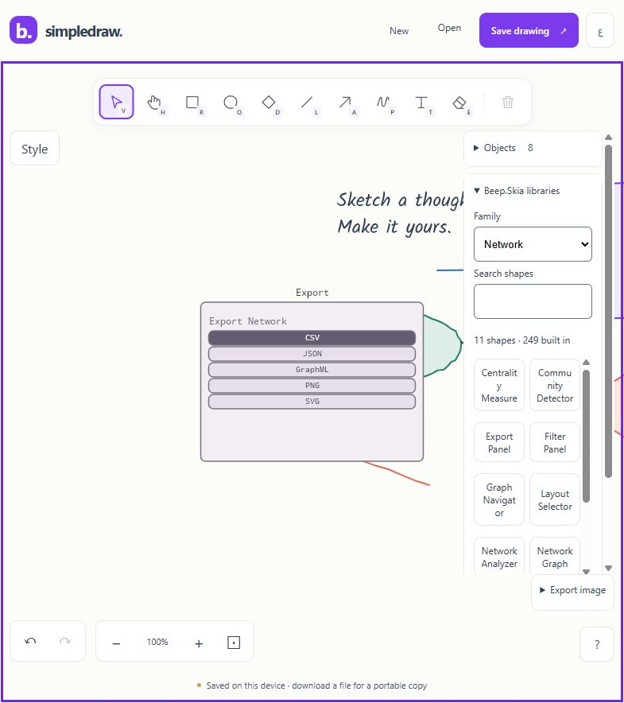
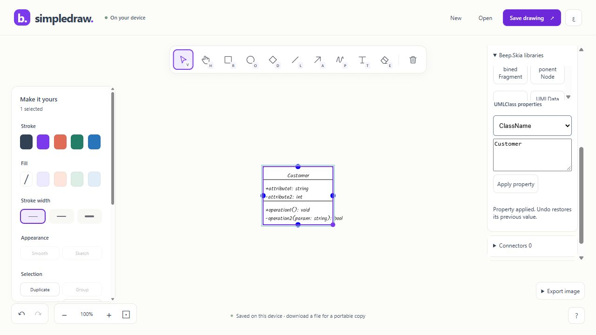

# Default Beep.Skia catalog

Delivered 2026-10-06. Open the [current preview](http://127.0.0.1:5243/draw/). The default open **Beep.Skia libraries** panel exposes 249 actual standalone components across 16 families. Select a family, search its shapes and click a component to insert it. Select a component to edit its named properties; Apply property enters the existing undo history. Complex values use JSON. The existing personal library saves reusable selections. Connections use the existing connector panel and actual component ports.

| Family | Standalone components |
|---|---:|
| FlowChart | 36 |
| UML | 19 |
| ERD | 3 |
| MindMap | 4 |
| Network | 11 |
| Business | 26 |
| Cloud | 22 |
| DFD | 17 |
| ECAD | 17 |
| ETL | 21 |
| ML | 18 |
| PM | 13 |
| Security | 9 |
| StateMachine | 8 |
| Quantitative | 24 |
| WellLogs | 1 |

The source audit found 250 concrete MaterialControl types. NetworkLink is a zero-size absolute-coordinate edge; it is excluded from standalone insertion. Specialized edge semantics are not represented by a second connector store. Desktop controls and loaders are host infrastructure. All nineteen required portable projects are compiled into the browser release, including the upstream project named Beep.Ski.Quantitative.

## Design and ownership

[Stage tasks and design](../plans/enhancements/P5_DEFAULT_SKIA_CATALOG.md), [SDD](SDD.md), [RACI](RACI.md) and [master tracker](../plans/enhancements/MASTER_TRACKER.md) record this delivery. Fixed typed factories retain metadata for trimming. The existing scene, DTO property bags, bounded native file parser, history actions, connector identities, rendering/export and personal-library insertion remain the shared paths. Files cannot resolve arbitrary CLR types. Native version 7 preserves earlier diagrams. Property edits validate a detached candidate before changing the live object; coupled properties normalize together.

Shared Beep.Skia changes add detached persistent identity restoration, respect export selection suppression in UML, preserve ERD column identities and route catalog default fonts through the configured bundled typeface cache. Ordinary desktop family targets and default font settings remain available.

## Verification

Candidate: `artifacts/default-skia-catalog-final-v2`. The native Release pipeline passes **542 C# and 77 JavaScript tests**, zero managed build/publish warnings or errors. The ordinary Beep.Skia regression passes **504 tests**. Each of 249 catalog factories is exercised for creation, strict native roundtrip, move/resize undo, personal-library copy identities and PNG/SVG export. Additional cases cover coupled property/style undo, invalid edit atomicity and cross-family connections.

Actual published Chromium smoke verified UMLClass insertion, ClassName=Customer, undo/redo, downloaded native version 7 and file reopening. With the port 5245 preview server terminated and zero listeners confirmed, reload restored the drawing and ERDEntity insertion worked offline. The original port 5243 app accepted the release update and restored all seven existing objects; the downloaded native drawing matches the prior document exactly after its envelope version migration. [Machine-readable evidence](evidence/default-skia-summary.json), [native UML file](evidence/default-skia-browser.simpledraw.json), [preserved preview drawing](evidence/default-skia-preview.simpledraw.json), [sibling regression log](evidence/default-skia-sibling-tests.log) and release logs retain the scope.

Source pin verification passes for **498 inputs**, SHA-256 `313d956c5a87cbc6fc8016335a80c77616462f3be12faf2db033136d4c85d777`. Packaging verifies 56 archives, 151 offline assets, 453 ZIP entries and 117 runtime payload mappings. Offline version is `b900747fc2ad94c9`; the whole compressed inventory is 8,456,214 bytes, within the unchanged 25 MiB gate. This is an inventory budget, not a measured cold network transfer.

Browser smoke covers UML and ERD; it does not prove all 249 shapes in every browser or every specialized property/layout combination. Long custom labels and generic export containment need broader scenarios. The first ordinary 1,000-object mixed benchmark on this candidate fails the unchanged 50 ms target at p95 108.7 ms, median 91.9 ms. [Raw failed run](evidence/default-skia-performance-run1.json) preserves 140 committed edits/paints and restored geometry. A fixed-key dictionary now replaces per-object linear catalog lookup; the corrected candidate is being built and will be remeasured before adoption. Physical devices, screen readers, other engines, real browser zoom, intended public hosting/hosted CI and independent owner/maintainer acceptance remain separate release checks. They do not suspend this authorized local implementation.

## Current optimized candidate

The default-catalog lookup correction is adopted in `artifacts/default-skia-catalog-indexed`, offline `8de7c128f221df23`. The native gate passes 542 C# + 77 JS again, and the unchanged 1,000-object mixed benchmark passes twice at p95 41.3/25.6 ms. The previous failed run remains retained. [Correction, raw timings and scope](DEFAULT_SKIA_PERFORMANCE.md) identify exact current packaging and runtime evidence. Earlier catalog smoke above remains recorded against its original candidate.

Current delivery: [catalog usability](DEFAULT_SKIA_USABILITY.md), candidate `artifacts/default-skia-catalog-usability-final`, adds Arabic controls, readable narrow labels and synchronized property history. Current mixed benchmark p95 is 33.2 ms; exact evidence and remaining scope are recorded there.

Latest C7 engineering verification: `artifacts/default-skia-catalog-port-stable` is adopted in the local preview; 568 C# / 77 JS and 504 ordinary sibling tests pass. Both original and current 249-component native galleries save byte-exactly through the corrected trimmed WASM; device reload restores 249 objects. The user preview restores ten objects after Update app. Source fingerprint `42d01696deb91a9e3e62c64fd374a0d372960e6cf68f04a68f643c0f01707fea`; 498 inputs; offline `248433f1f2308a04`; Brotli inventory 8,456,690 bytes. See docs/DEFAULT_SKIA_GALLERY.md (from repository root) for failed-before/fixed-after evidence, fixture reproduction, package hashes and verification limits. C7 local engineering checks are complete; independent device/host/release acceptance and broader plan gates remain open. Prior active/in-progress notes above are historical snapshots.
