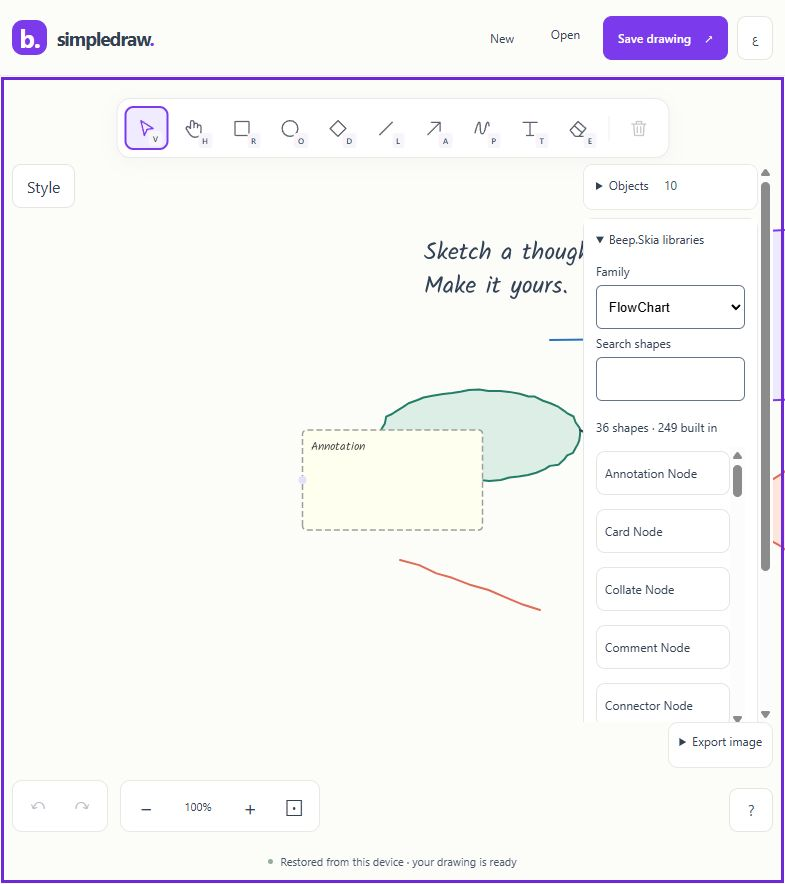

# Published Beep.Skia catalog verification

The default catalog embeds 249 standalone factories across sixteen families in the portable WebAssembly release. This follow-through exercises actual native files in the trimmed browser build rather than relying only on managed factory and pixel tests.

## Reproduce the fixtures

Run the ordinary release build first. The fixture tool uses the same compiled Core, catalog and DrawingSession insertion path, including the three existing FlowChart profiles. It creates one board for all families plus sixteen separate family boards, preserves default dimensions and properties, tiles the components, and verifies exact managed native roundtrips. Every output manifest records native version, type inventory, byte count and SHA-256. The output directory must be absent.

```powershell
dotnet restore scripts/SkiaCatalogFixtures/SkiaCatalogFixtures.csproj --configfile NuGet.Config --packages artifacts/packages --locked-mode -p:RestorePackagesWithLockFile=true -p:NuGetLockFilePath=packages.net10.lock.json -p:Configuration=Release -p:BeepSkiaPortableTargetFramework=net10.0 -p:GeneratePackageOnBuild=false -p:SkipMinVer=true -p:BeepSkiaLocalBuildCopies=false
dotnet run --project scripts/SkiaCatalogFixtures/SkiaCatalogFixtures.csproj -c Release --no-restore -p:BeepSkiaPortableTargetFramework=net10.0 -p:GeneratePackageOnBuild=false -p:SkipMinVer=true -p:BeepSkiaLocalBuildCopies=false -- artifacts/catalog-fixtures-new
```

Use an isolated local preview origin for fixture imports so the user's working drawing is preserved. Open a native fixture, check the object inventory, fit its board, inspect its rendering and capture warnings/errors. Save through the actual browser interface, then compare the downloaded file:

```powershell
python scripts/compare-native-documents.py source.simpledraw.json downloaded.simpledraw.json absent-report.json
```

The comparator checks component identities, port identities, properties, geometry and graph state semantically, ignoring only JSON formatting and equivalent numeric representation. It exits nonzero on any difference; reports are never overwritten.

## Defect found and correction

The initial `default-skia-catalog-usability-final` browser imported all 249 objects and all sixteen family boards. Captured warnings/errors were empty. However, its actual downloaded full board differed in twelve fields across four Business types: ConditionBuilder reduced outputs from two to one; EventNode added an input; Group and RuleFlow removed their inputs and outputs. [Retained comparison](evidence/default-skia-gallery-before-fix-diff.json), [source native board](evidence/default-skia-gallery-source.simpledraw.json) and [actual downloaded board](evidence/default-skia-gallery-before-fix.simpledraw.json) preserve the failure.

Business LayoutPorts overrides called EnsurePortCounts while drawing. The shared library now positions existing ports in layout; topology changes occur during construction or explicit model changes. Group and RuleFlow initialize their intended zero-port defaults during construction, and restored/configured ports receive the shared base layout. Native identity and graph state must remain stable through canvas, PNG and SVG rendering. The existing 249-factory tests now compare serialization before/after raster/vector exports, and 26 Business cases configure three inputs/four outputs through the library and verify canvas/export preserve those identities and counts. The focused 279-case suite passes.

## Scope

The fixture defaults include upstream sample labels and values; they are diagram examples, not execution of business, cloud, quantitative or well-log workflows. Browser screenshots show rendering at fitted scales, including UI overlays; they do not certify every property's appearance or all possible custom text bounds. All-family throughput, physical touch, screen readers, other engines and independent release acceptance remain separate gates. Initial rapidly repeated imports captured pending save status; only an observed completed native file establishes download completion. Final published recheck results are recorded below when complete.


## Verified corrected release

The adopted candidate is `artifacts/default-skia-catalog-port-stable`, offline `248433f1f2308a04`. The full pipeline passes **568 C# and 77 JavaScript checks** with zero managed build/publish warnings/errors. The ordinary sibling regression passes **504 tests** after the shared Business changes. All 498 pinned source files, 56 package archives, 151 offline assets, 117 runtime payload mappings and 453 ZIP entries pass their gates. Brotli inventory is 8,456,690 bytes; ZIP SHA-256 is `75c628d3e4588261d5f2552290e4294e0eeff9d58f67477c5ce3a092f22866a5`. The reviewed source fingerprint is `42d01696deb91a9e3e62c64fd374a0d372960e6cf68f04a68f643c0f01707fea`.

Actual downloads from the corrected WASM are byte-for-byte equal to both the original 249-component fixture (247,877 bytes) and freshly generated current defaults (247,645 bytes). Both semantic reports contain zero differences, including all port identities. Reload restores all 249 objects from device storage; captured warning/error logs remain empty. [Original-default comparison](evidence/default-skia-gallery-after-fix-diff.json), [current-default comparison](evidence/default-skia-gallery-current-defaults-diff.json), [browser proof](evidence/default-skia-gallery-final-browser.json), [factory manifest](evidence/default-skia-gallery-current-defaults-manifest.json) and [release summary](evidence/default-skia-gallery-release-summary.json) retain the evidence. The download observer timed out although actual files completed; file contents and timestamps were used to establish completion.

The main [preview](http://127.0.0.1:5243/draw/) now serves this corrected release. The user tab's Update app action restored its ten objects; that check confirms visible count/restore, not byte comparison of the user's drawing. Previous immutable artifacts and failed gallery evidence are retained. Performance was not remeasured after this port-layout correction; earlier mixed-board timing remains scoped to its earlier release.


