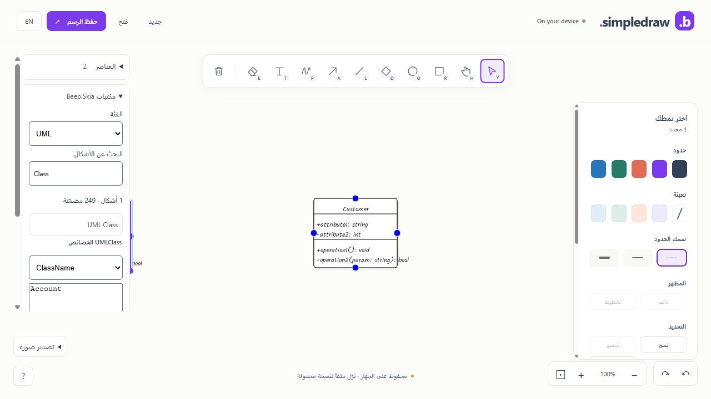

# Default catalog usability

The default catalog now uses the existing English/Arabic interface resources for its family/search/property controls, empty state and success messages. Technical family/type/property identifiers remain invariant; English language metadata and bidirectional isolation keep them readable in the Arabic shell. Display labels separate acronym prefixes, for example ECAD Microcontroller Node and ML Hyperparameter Tuning Node. The existing inspector uses one column so names fit its narrow width.

The property editor follows existing committed component state on Undo/Redo. It compares the currently observed property with its previous committed value and updates the field when that value changes. Ordinary rerenders and a language switch preserve an unfinished draft. Apply continues through the validated DrawingSession property edit and existing history; property input is transient UI state.

## Actual verification

Candidate `artifacts/default-skia-catalog-usability-final`, offline `8a1be1c214dcce2c`, passes 542 C# and 77 JavaScript checks with zero managed build/publish warnings/errors. All 498 sibling source inputs, 56 archives, 151 offline assets, 117 runtime payload mappings and 453 ZIP entries pass their existing gates. Brotli inventory is 8,456,847 bytes; ZIP SHA-256 is `62f505aedd6befd9a63c5f4ecabf6623020b47fe8532d1b3fc1d7b18da141dbc`. Sibling inputs remain unchanged from the 504-test regression.

Actual published Chromium checks cover Arabic controls and empty search, English technical names, ClassName property editing, live success-message translation, and keyboard Tab to Apply followed by Enter. An unfinished Account draft remains after changing language. Applying Account updates the field; Undo restores ClassName and Redo restores Account. The [captured inspector values](evidence/default-skia-usability-inspector.json) record this regression.

All sixteen families were visited at 320x720 in both English and Arabic: 498 total observed button instances, exactly 249 per language, no horizontal list/document overflow and all shape targets at least 44px high. [Full narrow audit](evidence/default-skia-usability-320-final.json) retains widths/counts/target dimensions. The [earlier audit](evidence/default-skia-usability-320-before-labels.json) preserves the ECAD and ML overflows that prompted the display-label correction.

The final release's ordinary 1,000-object mixed benchmark passes at median 25.1 ms / p95 33.2 ms against the unchanged 50 ms target. It completes 140 edits and paints, 20 warmup and 120 measured samples, restores geometry and retains bounded 100-entry history. Profiling is off, viewport 1280x720/DPR 1, visible embedded Chromium 154; no builds ran during measurement. [Raw current performance](evidence/default-skia-usability-performance.json) and [verified delivery summary](evidence/default-skia-usability-summary.json) preserve scope.

The current [preview](http://127.0.0.1:5243/draw/) serves this release. [Stage design/tasks/RACI](../plans/enhancements/P5_DEFAULT_SKIA_CATALOG.md), [SDD](SDD.md) and [master tracker](../plans/enhancements/MASTER_TRACKER.md) record the delivery. These are actual CSS viewport/embedded Chromium checks; physical touch, real browser zoom/high-DPI, screen readers, other engines, independent editorial review and public-host/CI/release acceptance remain open. Technical diagnostic errors may remain in their original language. Current timing covers mixed sketch/text with the catalog open, not all-family board throughput.

Latest C7 engineering verification: `artifacts/default-skia-catalog-port-stable` is adopted in the local preview; 568 C# / 77 JS and 504 ordinary sibling tests pass. Both original and current 249-component native galleries save byte-exactly through the corrected trimmed WASM; device reload restores 249 objects. The user preview restores ten objects after Update app. Source fingerprint `42d01696deb91a9e3e62c64fd374a0d372960e6cf68f04a68f643c0f01707fea`; 498 inputs; offline `248433f1f2308a04`; Brotli inventory 8,456,690 bytes. See docs/DEFAULT_SKIA_GALLERY.md (from repository root) for failed-before/fixed-after evidence, fixture reproduction, package hashes and verification limits. C7 local engineering checks are complete; independent device/host/release acceptance and broader plan gates remain open. Prior active/in-progress notes above are historical snapshots.
