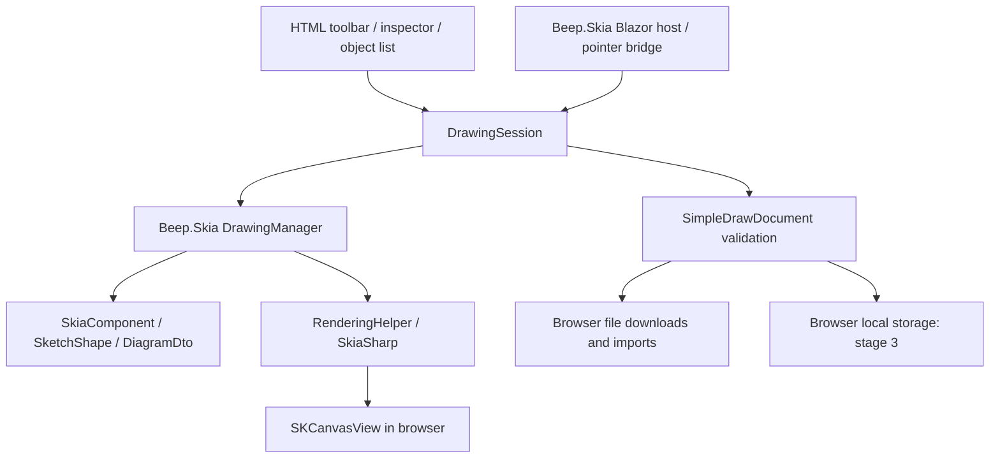

# Software Design Document: Beep.SimpleDraw
Date: 2026-10-05. Baseline: a new app; no production compatibility obligation.
This is the architecture contract. [Master tracker](../plans/enhancements/MASTER_TRACKER.md) owns delivery status.

## Architecture

## Deployment and portability
Standalone net10.0 Blazor WASM PWA. Publish emits static assets under wwwroot. No server circuit, database, or mandatory API. Serve over HTTP for local development and HTTPS in production. Opening index.html via file:// is not a supported deployment.
Native Skia WebAssembly linking uses wasm-tools on the build machine. Users need only a supported browser. A development ProjectReference to ../Beep.Skia is intentional; packaged build reproducibility is addressed in P6.
The standard PWA worker uses release assets; development does not prove offline readiness. Deploy with a configurable base href, correct wasm MIME types, index fallback, and versioned asset cache.

## Reuse assessment grounded in existing code
- ../Beep.Skia/Beep.Skia/DrawingManager.Core.cs: DrawingManager, ToDto(), LoadFromDto(), Zoom, PanOffset.
- ../Beep.Skia/Beep.Skia/DrawingManager.Components.cs: AddComponent(), RemoveComponent(), MoveSelectedComponents(), GetComponents(), DeleteSelectedComponents().
- ../Beep.Skia/Beep.Skia/SelectionManager.cs: SelectComponent(), ClearSelection().
- ../Beep.Skia/Beep.Skia/HistoryManager.cs: ExecuteAction() records an ALREADY APPLIED action; do not execute it a second time.
- ../Beep.Skia/Beep.Skia/RenderingHelper.cs: DrawAll() applies viewport once; DrawForExport() excludes viewport/grid/adorners.
- ../Beep.Skia/Beep.Skia/Serialization/DiagramSerialization.cs: DiagramDto and ComponentDto are the only scene serialization contracts.
- ../Beep.Skia/Beep.Skia.Blazor.Controls/SkiaHostComponent.cs now renders SKCanvasView and exposes CSS-pixel pointer/overlay hooks while retaining its public manager and descriptor surface.
- The broader core references Beep data/visualization packages, reflection, and desktop export APIs. Measure WASM payload/trimming and do not import automation/desktop hosts into the app.

## Components and responsibility
| Boundary | Responsibility |
|---|---|
| Beep.Skia.Components.SketchShape | Reusable sketch geometry, style, rendering, shape hit testing |
| Beep.Skia.Blazor.Controls.SkiaHostComponent | Render canvas; CSS-pixel pointer capture; paint scheduling; lifecycle cleanup |
| Browser pointer module | Capture primary pointer; queue ordered events; report cancellation; prevent touch browser gestures only over canvas |
| Beep.SimpleDraw.Core.DrawingSession | Tool gesture state, preview, commit, selection and existing history invocation |
| Beep.SimpleDraw.Core.SimpleDrawDocument | Validate complete DTO before mutation; build sketches and three reviewed concrete Flowchart families |
| Beep.SimpleDraw.Core.Library.FlowchartDefinitions | Exact family-key/property validator and concrete factories over ComponentDto |
| Web Home component | Accessible toolbar, inspector, file actions, messages, responsive layout |
| Browser document module (P3) | Storage and download capability; report failure; no scene ownership |

No second scene, undo stack, renderer, or generic component registry. Draft shape lives outside the manager until pointer release. UI lists project the manager's active components.

## Rendering resources and performance diagnostics
SketchShape retains native geometry/paint and bundled glyph-outline recordings in the existing renderer, with complete geometry/style/text invalidation and component-owned native disposal. Glyph recordings preserve the original absolute commands; changing position invalidates the affected text recording. Empty child lists avoid constructing a sorted iterator; nonempty child priority behavior remains unchanged. ObjectList retains only displayed row data and component references, recomputes duplicate-name counts on content changes and skips HTML rendering for geometry-only edits. File replacement with repeated IDs still invalidates by component reference. DrawingManager remains the only scene.

`?diagnostics=1` imports a local, source-owned benchmark module and shows raw measurements in an opt-in HTML panel. It invokes ordinary keyboard/history commands and observes the real shared paint callback, verifies revisions/geometry/bounded history and refuses invalid runs. It does not transmit data. [P6 performance evidence](P6_PERFORMANCE.md) records both failed and passing candidates and distinguishes loopback startup from an unverified cold broadband gate.

## Coordinates and interaction
Pointer location is clientX/clientY minus host boundingClientRect in CSS pixels. SKCanvasView IgnorePixelScaling=true aligns the paint context to CSS coordinates while retaining device pixels.

The [native raster trials](P6_RASTER_TRIALS.md) reject Alpha8 glyph composition and clipped retained repainting by exact pixel checks. The [ink-bounds foundation](P6_INK_BOUNDS.md) adds conservative leaf footprints from existing geometry/glyph commands; text collects bounds only when queried. The [automatic frame cache](P6_FRAME_CACHE.md) now uses the same renderer and full-canvas raster commands, selecting known contributors and copying proven damage into retained pixels. Unknown effects require ordinary full rendering; exports retain their existing renderer path. Host overlays supply old/current CSS-space footprints. Twenty-seven exact frame tests cover visual, membership, order, history, viewport and overlay changes. Native browser adoption and performance are separate gates recorded in the master tracker.

The production [session overlays](P6_SESSION_OVERLAYS.md) now expose `DrawingSession.DrawOverlay(SKCanvas)` and `GetOverlayInkBounds()`; Home delegates to those existing paint/bounds commands and keeps measurement/scheduling callbacks. Forty-eight tests execute real gesture/selection/cancellation states over 528 exact frames, proving both cached/ordinary pixel equality and actual overlay-footprint containment at three zooms and two device transforms. No scene, history or UI rendering authority is duplicated.
world=(screen-pan)/zoom; screen=world*zoom+pan. DPR is never multiplied into document geometry.
Idle -> drawing / dragging / panning -> pointer release commits one history entry -> idle.
Pointer cancellation, Escape, lost capture, and disposal remove preview or restore a moved object's start position. Secondary pointers do not replace an active gesture.
Existing manager interaction is available to other host consumers. SimpleDraw opts into its tool callbacks and disables default manager interaction to prevent double handling.
Viewport actions do not pollute drawing history. New documents/imports cancel active gestures and clear history only after complete validation.

## Document contract
SimpleDraw native envelope: { format: "beep.simpledraw", version: 6, diagram: DiagramDto }.
DiagramDto schemaVersion=3 includes stable component IDs. Component types are emitted as stable full names, not assembly versions. Import uses explicit SketchShape/ProcessNode/DecisionNode/StartEndNode factories; never run arbitrary Type.GetType/Activator on an uploaded name.
Sketches persist exactly Kind, Stroke, Fill, StrokeWidth, PathData, DisplayText, TextFontSize, GroupId, Roughness and SketchSeed. The three Flowchart types persist exactly InPortCount, OutPortCount, CustomFillColor, CustomStrokeColor, CustomTextColor, Label, ShowTopBottomPorts, NodeStrokeWidth, LabelFontSize and GroupId, plus their ordered port IDs. Component/port/group identities must be distinct across the document; groups need at least two members. Family labels use required bundled Kalam glyphs and bounded single-line content; geometry is at least 20 units per side. Reject unknown types/properties, unsupported connector metadata, duplicate/empty IDs, orphan groups, nonfinite/oversized geometry, invalid colors, excess property sizes, malformed JSON and unsupported versions. Reviewed static connectors use directional port GUIDs, three routing modes, bounded supported labels, 2 px strokes and 4–32 unit arrows. Each port accepts one edge. Cycles are drawable without execution. Animation, ERD/status/schema/transition metadata and component-index endpoints are rejected.
V1/V2 migrate the original strict schema and assign IDs. V3 preserves IDs and explicitly normalizes early host-rounded text bounds to portable linear Kalam metrics. V4 preserves saved bounds with the existing 0.1 px validation tolerance; actual WASM versus Windows measurement differs by less than 0.001 px in the fixture. JSON uses LF on all platforms. Font and glyph requirements are explicit; no silent platform substitution.
V4 and V5 migrate to V6 without changing valid object data or identities; versions 1–5 still reject every connector. Earlier versions explicitly reject families that did not exist in their contract. Import validates before replacing the board. Original invalid stored bytes must remain available for recovery; no silent reset or overwrite.

## History and serialization
Manager owns component identity and order. Shape create/remove use existing manager actions. Drag records MoveComponentsAction once after applying displacement. Styles in P2 use an existing DrawingAction subtype with before/after values.
Envelope serialization reads ToDto(), replacing family values with invariant reviewed captures; import validates DTO then creates only the permitted components using AddComponent and exact configured connectors through DrawingManager.ConnectComponents and clears the import-time history. Core's permissive reflection loader remains for trusted general diagrams, not browser uploads. ComponentEditAction records immutable family values and reuses SketchEditAction.State for sketches; applying undo changes the same scene instances. GroupId belongs to SkiaComponent. Selection, movement, sweep erasing, groups, order, numeric/handle resize, duplication and styles work across reviewed types. Sketch appearance is explicitly unavailable for family objects. A single selected family exposes validated label editing; template palette starts collapsed.

## Persistence and exports (P3)
Autosave after committed document changes, not each pointer move. Serialize revision N, save it, then acknowledge N; if N+1 arrives, schedule again. Storage key is app/schema specific; failed writes remain dirty.
Native file download uses Blob/object URL with cleanup. PNG/SVG render through RenderingHelper.DrawForExport(), bounds plus margin, explicit background, bounded dimensions. Never export selection overlays. Asset insertion remains gated until image limits and schema are defined.
The browser module holds an exclusive Web Lock for its lifetime, scoped by origin and base path. Without Web Locks, local autosave is disabled and the user chooses a file-only copy. A second tab must retry after closing the writer or choose file-only editing. Compare-before-write also detects external storage changes. An unreadable record is preserved and autosave pauses until explicit recovery replacement. These are implemented boundaries; the tracker records verified scenarios.
Local storage envelope version 1 contains revision and the strict native JSON string. Acknowledging revision N never clears pending N+1. Storage errors keep edits in memory with explicit retry/download UI. Portable file download and local durability have separate state. Before-unload guards pending changes/text edits.
PNG/SVG exports have 8192-pixel per-side and 16-million-pixel budgets, scales 0.25–4, content bounds including arrowheads and stroke, and optional paper background. Shared Skia SVG output contains glyph outlines and no external font dependency.
Production worker caches release assets with integrity hashes including bundled fonts. Cache names and navigation are base-path scoped. Updates wait by default; explicit activation requires no pending local changes/gesture/text and only one editor client, protecting other open tabs.

## UX and accessibility
Centered compact tools; title/file actions; optional left style inspector; lower viewport/history controls; empty-board guidance; visible dirty/save/error states.
HTML controls with names, focus styles and shortcuts; canvas has a named focus region; object list is keyboard navigation alternative. Do not claim canvas pixels alone are accessible.
Responsive toolbar wraps and the inspector collapses at 320 CSS px. Enter/arrow creation, numeric resize, modal focus boundaries and bilingual shell resources are implemented through the existing scene/history. Text editing uses an HTML input overlay and commits once; resizing the viewport preserves its draft. Opt-in touch promotion cancels the active preview before centroid-based pan/zoom, with bounded pen metadata and palm refusal. Pointer type is not a condition for basic feature access. [The P4 matrix](P4_TEST_MATRIX.md) separates verified desktop/reflow workflows from open actual 200% zoom, physical device, screen-reader and editorial checks.

## Failure handling
| Failure | Behavior |
|---|---|
| Skia startup/native assets | Visible application error and reload action; no pretend renderer |
| Pointer lost / cancel | Revert preview move; no history entry |
| Invalid document | Show validation error; retain current board |
| Unsupported file version | Reject with supported version information |
| Storage quota/permission | Dirty indicator; export still works |
| Offline deployment missing assets | Honest offline-unavailable state; P6 gate remains open |
| Trimmed reflected shape properties | Explicit typed sketch properties and roundtrip release tests |
| Large image/export | Reject above limits before allocating |

## Security and simplicity
All files are local and untrusted. No uploaded-code execution, HTML rendering from document text, arbitrary external asset URLs, credentials, or network collaboration in the default app.
Apply maximum bytes before reading files and structural limits after parsing. Escape user text in SVG; reject active SVG imports until safe rasterization is specified.
Self-hosted release assets and fonts. CSP/trimming/browser matrix, dependency audits, and real offline tests belong to P6.

## Verification
Core tests exercise gestures, transforms, one-action history, cancel restoration, and native document validation. Renderer tests create a real Skia surface. Browser smoke proves pointer delivery and actual canvas pixels, not merely server HTTP 200.
Release test additionally publishes and exercises installed/offline refresh. Tracker distinguishes source implemented, automated verified, browser verified, and accepted.

ConnectComponentsAction and DisconnectComponentsAction retain exact line objects, ports, styles and paint positions. Central AddLine/RemoveLine settle port availability and component relationships; delete/clear/rewire use those same paths. Library and duplicate subsets retain internal edges only. Insertion remaps every port reference before complete combined-board validation and a single batch. ConnectionLine requires bundled glyph outlines in this host; its shared path/label bounds feed the existing export renderer. Connector controls and a connected workflow preset start collapsed.

## Pinned build and deployment boundary
Build inputs use [ADR 002](decisions/002-pinned-build-inputs.md): one reviewed sibling source snapshot, seven net10 locks, two exact bundled owner archives and declared nuget.org resolution for other packages. The scoped `BeepSkiaPortableTargetFramework` property preserves ordinary sibling targets while giving this app one Release project instance per reference. Local packaging/copy targets are explicitly disabled. Archive/extracted-file verification, nonzero C# test counters and actual native-Skia toolchain checks precede release packaging.

The portable runtime is the native-linked static `wwwroot`, with artifact-specific base path, offline content version, SRI/encoding inventory, CSP and provenance. No SDK/Node/package feed is needed in production. Finalization normalizes HTML inline-script hashes and regenerates only legitimate changed entry/worker encodings after validating original assets. The reference host enforces mount/MIME/compression/cache/CSP; its root/subpath/offline/update desktop evidence is recorded separately from public deployment, installed-app/device and measured-performance acceptance. See [build](BUILD_REPRODUCIBILITY.md) and [deployment](DEPLOYMENT.md).

Full original license/vendor notices are pinned with build inputs and delivered through static `licenses/` files and the existing offline manifest. Help links to the semantic page in both interface languages; vendor texts remain untranslated. Before packaging, actual runtime payloads map to exact package/SDK/source inputs, required notice groups and file hashes. Unknown sources or notice drift fail the gate. Conservative additional vendor notices and independent ownership/header review remain explicit. See [notice verification](P6_NOTICES_VERIFICATION.md).

Local diagnostics require `?diagnostics=1`. The ordinary editing benchmark uses the product Shortcut/scene/history/autosave path. A separate disposable 5,000-object renderer scene uses the existing Beep.Skia DrawingManager, shared history and SkiaHostComponent; it never enters product files or autosave. Both drivers wait for actual canvas paints, retain raw presentation samples in the DOM and verify restored geometry and bounded history. Closing/cancelling stress releases temporary resources and checks unchanged product bytes/revision. Native documents stay bounded at 2 MiB/2,000 components. See [protocol and evidence](P6_PERFORMANCE.md); focused desktop stress completion does not imply the 1,000-object budget or device/network acceptance.

The shared host coalesces pending paint requests and retains a follow-up requested during its synchronous paint callback. Optional diagnostic counters verify host dispatches/completed paints; `profile=1` additionally records CPU scene paint and command completion without changing the ordinary path or acceptance budget. Counters exclude vendor resize/DPI events and CPU paint excludes pixel transfer/presentation. Exact renderer comparisons use independent original glyph commands across movement/layout/color/scale changes. Current browser scheduling passes; mixed p95 remains above budget. See [P6 design](../plans/enhancements/P6_RELEASE_DESIGN.md).

Controlled startup verification uses an optional encoded-body pacing/response-delay wrapper on the existing static host. One reservation clock enforces the aggregate cap across concurrent responses; ordinary production streaming is unchanged. Fresh-origin browser reports and server body captures distinguish usable board startup from completion of offline population. The named desktop scenario passes; physical provider, public host, newly launched cold browser process and independent acceptance remain separate. Ten canvas-state/opacity/child-isolation tests are retained after reverting a leaf isolation optimization that failed the mixed budget.

The generated notices page uses a source-owned module to retrieve the cached aggregate as raw bytes and invoke the existing editor byte-download helper. Pending reads disable repeat activation; failures are visible and permit retry. Packaging verifies both modules against app source and offline integrity. The [notice gate](P6_OFFLINE_NOTICES.md) distinguishes actual directly controlled file completion from separate popup request status and independent rights/header acceptance.

## Default compiled Beep.Skia catalog

The default diagram palette embeds nineteen sibling projects and 249 fixed standalone factories across sixteen families. SkiaCatalog extends the existing DiagramDto property bags, native envelope version 7, ComponentEditAction history, DrawingManager rendering, connector identities, export and personal-library insertion. Detached identity restoration validates shared physical ports before scene registration. Fixed property metadata is retained for WASM trimming; untrusted CLR type resolution is refused. Catalog edits normalize coupled label/display properties before strict roundtrip validation. DrawingContext excludes UML selection adorners during export, and the application registers the bundled font through TypefaceCache. [Catalog design, usage and evidence](DEFAULT_SKIA_CATALOG.md) describe limits and verification.

The [catalog usability extension](DEFAULT_SKIA_USABILITY.md) uses UiText for controls/messages and bidirectional/language metadata for invariant identifiers. Its transient property input compares the last observed committed value with the live selected component, synchronizing undo/redo while retaining drafts during language/layout rerenders. Display-label humanization lives in the existing compiled catalog generator.

### Business port layout preserves the native graph

Business LayoutPorts overrides must only position existing ports. Port creation/removal belongs to constructors, explicit port-count setters and component-type changes. Rendering, fitting and image export must preserve component/port identities, count metadata and connections. Group and RuleFlow establish their zero-port defaults in constructors; restored or explicitly configured ports retain the shared base layout. A published-WASM gallery comparison exposed topology mutation that pixel-only roundtrip checks missed; existing catalog tests now compare native state before and after raster/vector rendering, and every Business factory exercises configured ports through canvas/export.

### Docked workspace and scroll navigation follow-through

The user selected a docked UI: tools/style on the left, canvas in the middle, Beep.Skia catalog/properties on the right. Desktop rails occupy grid tracks and do not cover the drawing; narrow screens stack the rails around the canvas. Text editing anchors within the center canvas, retaining existing inert/focus/modal boundaries. Ordinary wheel input pans; Shift+vertical wheel pans horizontally; Ctrl/Cmd+wheel zooms around the pointer. The shared host carries finite CSS-pixel horizontal/vertical deltas and normalizes line/page units; DrawingSession owns viewport changes without changing native geometry/history. Existing host default-interaction behavior retains its existing zoom policy. The four remaining shell labels use existing resources. Meaningful viewport/bridge checks and the published responsive/scroll/modal verification are recorded in docs/DEFAULT_SKIA_SHELL_AND_BOUNDS.md. Shared WellLogs brushes are clipped to their supplied rectangle and restore caller canvas state, addressing the actual gallery ink overflow; all eleven brush containment tests pass after eight failed before correction. These local corrections do not imply independent editorial/device acceptance. Verification and adoption are in progress until the final release record below.

## MCP for Claude and Codex

MCP exposes one shared DrawingSession/SkiaCatalog/native graph through stdio and optional loopback HTTP, with persistent workspace revisions, atomic cross-process writes, typed property discovery, exact text targeting, personal libraries and Beep.Skia PNG/SVG/native exports. See mcp/README.md and plans/enhancements/mcp for the per-stage design and gates.
