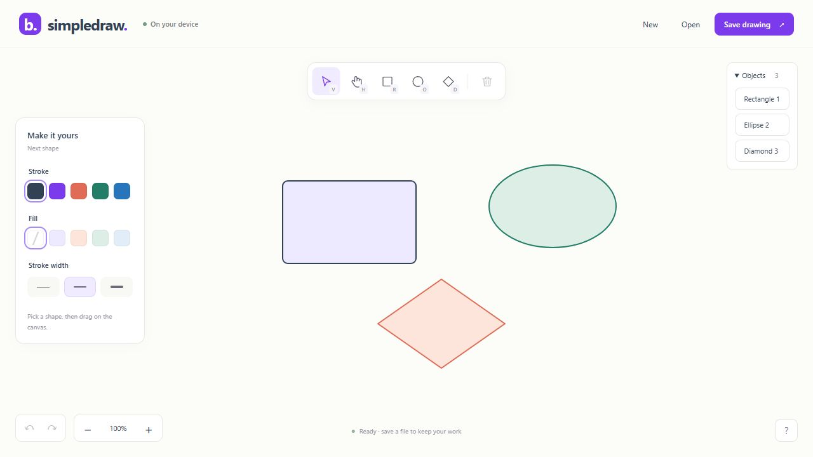
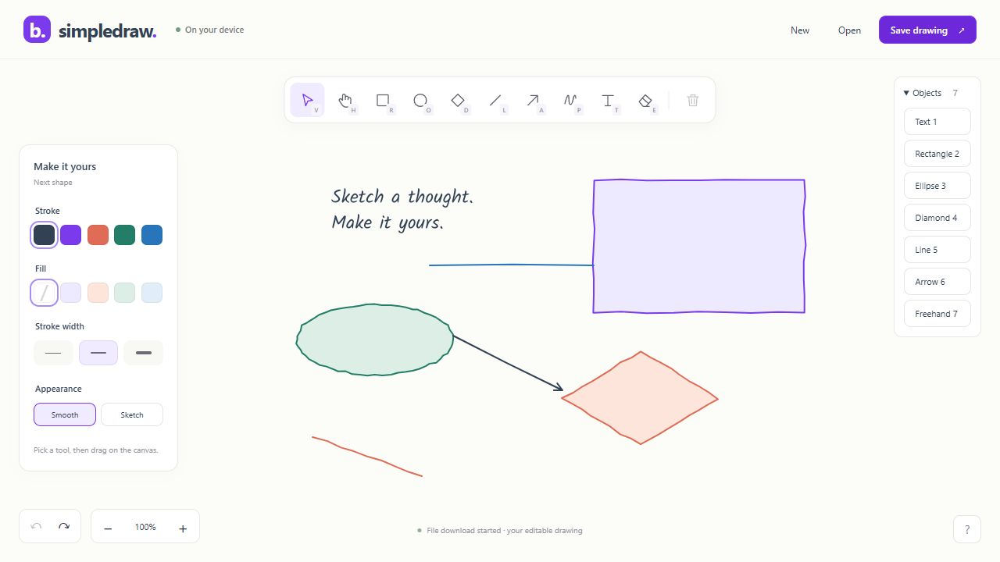
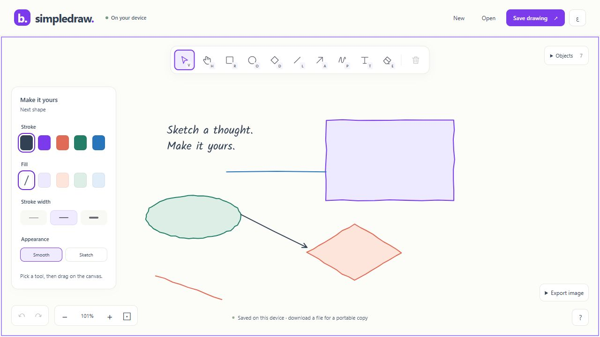

# P1 verification record
Latest P6 gate: the complete existing sibling Windows test project passes **504 tests, zero failed/skipped**, with its ordinary target graph built under warnings-as-errors. [Full regression evidence](P6_SIBLING_REGRESSION.md) retains initial failures, corrected graph/pixel fixtures, unchanged budgets and the passing rerun. Portable runtime/source pin are unchanged. Historical references below to an unrun sibling suite describe earlier increments; manual desktop/device checks and independent acceptance remain open.

Date: 2026-10-05. Scope: first implementation slice, not complete product readiness.

## Automated evidence
```powershell
dotnet build Beep.SimpleDraw.slnx -c Release --no-restore -p:GeneratePackageOnBuild=false -p:SkipMinVer=true -v:q
dotnet test tests/Beep.SimpleDraw.Tests -c Release --no-restore -p:GeneratePackageOnBuild=false -p:SkipMinVer=true -v:q
node --test tests/browser-bridge.test.mjs
dotnet build ../Beep.Skia/Beep.Skia.Blazor.Controls -f net8.0 -p:GeneratePackageOnBuild=false -p:SkipMinVer=true -v:q
dotnet publish src/Beep.SimpleDraw.Web -c Release --no-restore -o artifacts/release -p:GeneratePackageOnBuild=false -p:SkipMinVer=true -v:q
```
Release solution build: 0 warnings/errors. Focused C#: 16 passed, 0 failed. Browser bridge: 5 passed. Retained net8 host build: 0 warnings/errors. Release publish: successful assembly trimming and native Skia/WebAssembly link.

## Browser evidence
Actual Codex in-app desktop browser, 1280x720 viewport, using a Python static server bound to loopback.
Initial smoke at 127.0.0.1:5186; final revision verified on 127.0.0.1:5187 to load a new production cache version without overriding the deferred service-worker update policy.
The final clean static artifact is served on 127.0.0.1:5188 for an independent fresh-origin load. Earlier build output is retained under ignored artifacts; the canonical portable artifact is artifacts/release/wwwroot.
Browser engine/version and cross-browser matrix were not formally recorded; this is a desktop smoke, not browser certification.

| Scenario | Observed result |
|---|---|
| Empty board + canvas | Real Skia canvas rendered with named HTML controls |
| Rectangle/ellipse/diamond creation | Three shapes at independent pointer coordinates |
| Stroke/fill selection | Lavender rectangle, mint ellipse, peach diamond painted correctly |
| Select/drag + undo/redo | Shape moved and history restored/reapplied geometry |
| Hand pan / zoom / reset | Real pointer hand pan and zoom changed the viewport; reset restored 100% |
| Native save | Actual Drawing.simpledraw.json downloaded |
| Native reopen | Three shapes/colors restored; import history cleared |
| Invalid version 42 | Error displayed; existing three shapes preserved |
| Pointer release outside canvas | Release over top header completed shape, no stuck gesture |
| Delete | Selected test shape removed |
| New on changed drawing | Unsaved-work dialog shown; Keep drawing preserved shapes |
| Object list / keyboard | Rectangle selected; ArrowRight moved it; Ctrl+Z undid movement |
| Runtime logs | No application warning/error entries reported in final smoke |

[Native roundtrip evidence](evidence/p1-browser-roundtrip.simpledraw.json) is an exported synthetic smoke board.


## Artifact inventory
artifacts/release/wwwroot is self-contained static deployment output. Approximately 26.26 MiB raw assets; 6.93 MiB of generated Brotli assets (104 files). A server must serve Brotli with correct encoding to realize compressed transfer; the local Python smoke server served ordinary files.
No cold-start timing, p95 frame measurement, real-device performance or offline installation claim is inferred from these numbers.

## Tooling and restore notes
Development machine: .NET SDK 10.0.401; Python 3.14.3; Node 24.14.0; SkiaSharp 4.150.1.
The standard Debug DevServer package download hit DNS/connection timeouts. Release excludes that development-only package. Official NuGet HTTP cache packages were copied into ignored artifacts/restore-feed for the successful Release restore; source package versions were unchanged.
The wasm-tools installer completed successfully. `dotnet workload list` now reports wasm-tools 10.0.112/10.0.100 installed for SDK 10.0.400. Browser native packs successfully link the application.

## P2 editing increment — 2026-10-05
Release solution build passed with 0 warnings/errors. After the path-validation hardening, 30 focused C# tests pass and 6 Node pointer tests pass. Retained net8 host builds with 0 warnings/errors. A fresh trimmed/native-linked publish is at artifacts/p2-verified/wwwroot, served on loopback port 5190.

C# covers reversed/horizontal/vertical arrow endpoints and head tangents; actual horizontal line paint; distance and whole-sweep intersections; local freehand samples; eraser cancel/one undo/paint-order restoration; multi-object move/style undo; native path culture roundtrip; explicit v1 migration; malformed/degenerate/wrong-count path rejection before mutation. Node exercises 600 browser coalesced samples across batches of 256/256/88 with sample order and final pointer release retained.

Actual desktop browser smoke used published artifacts/p2-preview/wwwroot on port 5189 and the final validation snapshot on port 5190. At 1280x720, rectangle, reversed arrow, horizontal line and pen were created through real pointer input. The exported pen had nine sampled points. Object-list Shift-click selected two shapes; stroke/width changes painted both; two separate undos restored the original width and mixed colors. One eraser sweep removed arrow and line; one undo restored both in their original object order. The actual downloaded native version 2 file reopened with all four shapes and cleared history. The actual P1 version 1 file reopened with all three original colors. A malformed path import displayed an error and retained the four-object board.

[P2 native roundtrip evidence](evidence/p2-browser-roundtrip.simpledraw.json) is the actual exported synthetic smoke board. [P2 browser screenshot](evidence/p2-browser-smoke.png) records the final published view. No real pen device, mobile browser, screen reader, install/offline/update, or broad Beep.Skia regression is inferred from this desktop smoke. Text/resize/duplicate/reorder/group/sketch-style and the full P2 exit gate remain open.

## Open gates
Current gates: independent owner/Beep.Skia maintainer acceptance; broad sibling regression; fresh restore/release reproducibility; P4 physical touch/pen, screen-reader, other engines, actual 200% zoom/high-DPI and editorial review; P5 libraries; P6 installation/subpath/performance/dependency/release checks. P2/P3 and P4 desktop engineering evidence is recorded below; historical gate lists do not override the master tracker.

## Complete P2 editing — 2026-10-05
The final all-tool native-linked publish is artifacts/p2-final/wwwroot on loopback port 5192. Fifty focused C# tests pass; seven Node bridge tests pass. The retained net8 host builds with zero warnings/errors. Twelve existing sibling serialization/typeface tests pass; the complete sibling suite was not run.

Actual published desktop smoke created all seven kinds and edited each selected stroke with a single undo. Multiline text created, double-click edited, cancelled without mutation and committed through Ctrl+Enter; text undo/redo worked. Rectangle resize preview/commit and undo/redo were observed; the final artifact also verified arrow endpoint resize and undo. Grouped text/rectangle duplicate added two shapes and one undo restored the seven-object board; redo and undo preserved IDs and order. Ellipse front/back reorder and undo restored object order. Erasing grouped text removed both members and one undo restored them. The final build exposes true/false aria-pressed state and only working resize handles. No warning/error logs appeared in that final smoke.

[Actual v3 browser file](evidence/p2-full-browser-roundtrip.simpledraw.json) is retained as a migration fixture. [Actual v4 browser file](evidence/p2-final-browser-roundtrip.simpledraw.json) is parsed and roundtripped by native tests with IDs/groups/seeds unchanged and identical LF JSON bytes. Portable linear text metrics differ between WASM and Windows by 0.00049 px for the caption; this lies within the existing 0.1 px validator tolerance. Unsupported glyphs and materially wrong bounds are rejected. No guard was relaxed to accept a failing fixture.



P2 engineering delivery is verified; independent PO/SK acceptance and the P4 device/accessibility matrix remain open.

## P3 document implementation — automated evidence
Revision-aware autosave state, exclusive writer storage, preserved corrupt bytes, explicit file-only editing and retry, and bounded PNG/SVG exports are implemented. Fifty-six focused C# tests pass, including real PNG decode/dimensions/background/selection exclusion, SVG XML/content/active-reference checks, crop and allocation limits, actual browser downloads and late revision acknowledgment. Seventeen Node checks cover input plus storage contention/quota/corruption/future records/CAS/unavailable capability/limits and worker root/subpath/integrity/update/client/navigation behavior.

## P3 published browser evidence — 2026-10-05
Published artifacts/p3-verified/wwwroot on port 5193 restored the seven-object native board from autosave after reload. Actual PNG (671×401) and SVG downloads were copied into evidence and native tests decode/XML-parse them. Inspection caught default SVG text referring to installed Kalam; the shared SketchShape text renderer was corrected to draw glyph paths and the final SVG fixture must contain no text elements or font-family attributes. No separate export renderer was introduced.

With the Python server stopped (process exited after Ctrl+C), reload rendered every shape and the bundled font. An additional rectangle was created and autosaved offline, then another reload restored eight objects. [Offline screenshot](evidence/p3-offline-restore.png) records the seven-object initial restore; subsequent AX observations confirmed eight after editing/reload. This is actual server-unavailable behavior, not a mocked offline flag.

A second same-origin editor received the exclusive-writer dialog and retry remained refused while the writer was open. On fresh port 5194, tests/browser-faults.html seeded owned malformed bytes. Startup showed recovery with normal editing inert; reading storage still returned the original bytes. The recovery download contained exactly `{owned-test-corrupt`; explicit New then saved a fresh empty record. A seven-object import under a filled 5 MiB localStorage quota displayed a failed-save message and kept all seven objects in memory; the previous empty saved record was unchanged. Releasing only owned quota padding and clicking Retry saved the seven objects. Reload restored them. [Recovery](evidence/p3-corrupt-recovery.png) and [quota failure](evidence/p3-quota-failure.png) screenshots record these gates. The harness is not shipped.

For same-origin updates, the 5193 server restarted serving artifacts/p3-final-verified/wwwroot while the old editor stayed open. A new editor triggered installation; the existing editor exposed Update app. Activation while both tabs existed was refused with `Close other editor tabs before updating.` After closing the other tab, an open text draft disabled Update app ([evidence](evidence/p3-update-paused.png)). Cancelling the draft and choosing Update activated/reloaded the new worker and restored all eight saved objects; no warning/error logs appeared. Formal installation, other browser/device engines, denied-storage browser policy and the release subpath deployment remain P4/P6 checks.

Final source artifact: artifacts/p3-portable-glyphs/wwwroot, port 5196. An intermediate SKFont.GetTextPath implementation passed native tests but hit a Mono WASM P/Invoke assertion in the published browser; it was replaced with directly exported GetGlyphs/GetGlyphPositions/GetGlyphPath calls in the same shared renderer. The final browser painted text, exported PNG and a 37,383-byte SVG, and reported no warning/error logs. Native tests verify that the actual final SVG has no text/font-family/active/external references and that the actual PNG still has 671×401 dimensions. [Initial SVG](evidence/p3-initial-browser-export.svg) retains the caught installed-font dependency; [final SVG](evidence/p3-browser-export.svg) and [PNG](evidence/p3-browser-export.png) are actual downloads, not rewritten fixtures.

A second final-build tab chose a file-only copy and restored all seven saved objects. It added an eighth object and downloaded a native file; the writer stayed at seven, including after reload. Final preview evidence is [p3-final-browser-smoke.png](evidence/p3-final-browser-smoke.png). Current counts remain 56 C# and 17 Node tests; original net8 host build passes with zero warnings/errors. Independent owner acceptance and P4–P6 remain open.


## P4 usability implementation — 2026-10-05
Final artifact: artifacts/p4-complete/wwwroot, loopback port 5200. Release publish passed; retained net8 host builds with zero warnings/errors. **67 focused C# tests and 24 JavaScript checks pass.** [P4_TEST_MATRIX.md](P4_TEST_MATRIX.md) gives automated case coverage, actual desktop scenarios and open external/device gates.

Actual keyboard-only rectangle/line/pen/text creation, text cancel, object-list selection, movement/delete/undo and native file download passed. The downloaded four-object fixture reopened in a second origin and is checked by the native suite. Text/help/replacement focus boundaries wrap Tab, suppress background controls and return focus on Escape. Final numeric resize changed 60×40 to 120×80; one undo retained the object and restored both inputs. A text draft remained focused and intact across desktop-to-320px viewport resizing.

At 320×720 all 11 tool controls measured 44×44 and the document had no horizontal overflow. Mobile Style collapses, its content scrolls, and Arabic chrome mirrors with unchanged canvas geometry. The final Arabic language toggle also updates the selection announcement. A 640×360 modal reflow check passed; it is not an actual browser zoom test. Final port 5200 logs contained no warnings/errors. Physical Android/iOS, NVDA/VoiceOver, other engines, actual 200% zoom/high-DPI, OS contrast settings and Arabic editorial/independent review remain open.



## P5 libraries and reviewed family foundation — 2026-10-05

[P5_LIBRARY_VERIFICATION.md](P5_LIBRARY_VERIFICATION.md) records actual P5A desktop/offline/file/writer/320px evidence and the later closure of actual library quota/pending download/retry/reload and corrupt/future-payload recovery UI on unchanged P6 runtime, fresh origins 5229/5230. Exact byte comparisons and revisions pass; clean browser logs and 70 JS checks retained. Actual library and inserted-board downloads are native regression fixtures. Historical final P5A artifact is artifacts/p5-library-ready/wwwroot on 5203.

[P5_FAMILY_AUDIT.md](P5_FAMILY_AUDIT.md) records three selected existing Flowchart nodes, source findings and implemented strict definition/renderer/identity contracts. The current focused suite passes **116 C# tests and 25 JavaScript checks**. Retained net8 FlowChart build passes without warnings/errors. The existing sibling simulator/code-generator sources run as scoped regressions in the app test project; complete sibling desktop/family tests remain open. Factories are not yet exposed through native import or the product palette; connector/family editing and browser payload gates remain open.

Current source publishes to artifacts/p5-family-contracts/wwwroot on 5204. Existing seven-tool browser rendering and SVG export passed after shared glyph/group/clip changes, with clean warning/error logs. The actual SVG is byte-identical to the verified P3 glyph-outline export. The foundation adds 108,923 raw folder bytes and 28,745 Brotli bytes versus P5A ready; the active family workflow/startup gate remains open.

## P5 family-object editing — 2026-10-05

Native v5, explicit three-family factories and generic same-scene history are now integrated. **131 C# tests pass.** The earlier 25 JavaScript checks remain applicable; this increment changes no JavaScript source. [P5_FAMILY_AUDIT.md](P5_FAMILY_AUDIT.md) records automated and actual desktop evidence and the remaining connector work.

The published browser at 5205 created/edited all three real Beep types, resized with inspector undo/redo, grouped and saved to the library, inserted with one undo/redo, moved the copied group and downloaded native/library/PNG/SVG. Reload and native reopen restored six objects; unknown Execute metadata was refused without board replacement. Actual downloads are regression fixtures proving distinct groups, 24 unique component/port IDs and preserved geometry/styles/labels. SVG has no text/font-family/active/external content; actual PNG dimensions match shared native layout. The 320px palette has no horizontal overflow and ends above export controls. Final source artifact: artifacts/p5-family-verified/wwwroot on 5206. Strict connector capture/remapping/history and P6 release remain open; P4 device/accessibility and independent acceptance gates are unchanged.

## P5 connected graph increment — 2026-10-05
162 C# and 25 JS tests passed; native-linked Release publish and retained net8 FlowChart build passed. [Connector verification](P5_CONNECTOR_VERIFICATION.md) records exact history/ports/order, strict v6/native profile, internal-edge subset/remapping, real glyph PNG/SVG bounds, actual downloaded graph/library fixtures and server-stopped connected insertion/reload. Final preview 5209. Folder inventory 28,762,011 raw / 7,538,993 Brotli bytes (+188,339/+50,631 vs P5A). These are focused engineering results; independent/device/installation/library recovery UI and P6 gates remain open.

Final connector UI at 320×720: no horizontal page overflow, all six fields 44 px high, side panel scrolls independently. Native metadata refusal retains six nodes/six edges; final published PNG/SVG downloads replace the intermediate export fixtures. Final app warning/error log empty. User preview shows six nodes/four forward edges; six-edge downloaded fixtures remain the regression inputs.

## P6 pinned build and desktop hosting — 2026-10-05
[Detailed verification](P6_BUILD_HOST_VERIFICATION.md) records fresh 209-file sibling reconstruction, declared-feed isolated restore, 56 archive/1,106 extracted-file checks and actual tamper refusals. Final scoped Release gate passed 162 C# + 47 JavaScript tests, zero-warning native link and 324 ZIP entries. Latest subpath Brotli inventory is 7,975,472 bytes, below 25 MiB; this is not a measured startup/frame result. Reports/provenance and downloaded native/PNG/SVG fixtures are retained.

Actual desktop root/subpath startups and exports passed under the artifact CSP. Both servers stopped before offline reload; boards restored, and an offline edit survived save/reload. Same-origin update preserved a draft/disabled activation, refused while another editor was open, then activated and restored the graph. HTML CRLF inline-script hashing was corrected after browser evidence exposed it and now has regression coverage. Final logs are clean. Hosted CI is configured but unrun; complete notices/guides, performance, public-host/formal installation, other engines/devices/accessibility and independent acceptance remain open.

## P6 measured rendering and object list — 2026-10-05
[Performance evidence](P6_PERFORMANCE.md) records actual 100/1,000/2,000-object editor runs. The 1,000 rough-rectangle p95 improved from 266.1 ms to 39.4/35.7 ms using retained shared native resources and removal of quadratic HTML list work. Mixed-tool text-edit p95 is still 50.4 ms against 50 ms; a regressing local-glyph translation experiment was reverted. At this increment the sibling source digest is `4480b3d6900729991876b5fd315c46f1ff229006bd54e951651fd9eb5f23bbe1`. The native-linked candidate passed 171 C# + 51 JS; two additional exact original-glyph pixel checks bring the focused managed suite to 173 passing cases. Current runtime is the same as the verified leaf candidate; complete sibling regressions remain open.

Actual desktop list checks passed group/Shift selection, group/duplicate/undo/order labels, Arabic/English changes and same-ID replacement followed by a real canvas command. The downloaded replacement confirms movement of the new active instances to X=501/841. Real PNG/SVG exports succeeded without SVG font/active/external content; warning/error logs are empty. A 2,000-object mixed board was edited/downloaded; duplication at the cap was refused. The oversized 5,000 native file was refused while preserving the old board. Loopback startup observations and compressed artifact inventory do not prove shaped cold broadband startup or separate 5,000-object renderer stress. Complete notices, library recovery UI, external/device/host/install/acceptance gates remain open.

Final current-source `artifacts/p6-performance-verified` passed all 173 C# and 51 JS checks, zero-warning native-linked Release, package/source/toolchain integrity and 327 ZIP comparisons. Every published identity/compressed file is SHA256-identical to the actual browser-tested leaf candidate. Final reports/provenance/archive hash are linked in the performance document; scope remains focused desktop engineering.

## P6 separate renderer stress increment

Historical `artifacts/p6-renderer-stress` passes 175 C# + 60 JS tests, zero-warning native-linked Release, exact source/package/toolchain gates, 134 offline asset hashes/encodings and 402 ZIP comparisons. The packaged candidate was tested directly at `/draw/` on port 5221. A disposable 5,000-object scene uses the actual shared DrawingManager/history/SkiaHostComponent and never enters native documents or autosave. Rectangle and mixed cases each completed 140 moves and 141 actual paints, restored geometry and bounded history. Rectangle p95 was 77.4 ms; mixed 109.2 ms, repeated mixed 126.7 ms. The 1,000-object product budget is not assigned to this stress case.

Closing, cancelling an active run and Escape preserved product serialized bytes/revision; Escape restored launch-button focus. The ordinary URL restored the saved product drawing and omitted diagnostic controls. That exact candidate also restored its seven-object drawing after the preview server stopped. Browser warning/error logs were empty. The ordinary 1,000-object mixed benchmark remains a failure at p95 50.4 ms. See [protocol, raw evidence and current build reports](P6_PERFORMANCE.md). Shaped broadband startup and external/independent gates remain open; the successful separate stress case does not close those gates.

## P6 shared paint profiling and scheduling increment

Current `artifacts/p6-render-dispatch` passes 178 C# + 66 JS, zero-warning native-linked Release and original net8 host compilation, exact pinned source/packages/toolchain, 134 offline assets and all 402 ZIP comparisons. Its source digest is `b80560e6fcddb0ba973287babfe178312819b5e19de0e94b421a4c5356f46568`; offline version `19e9a4459b614eef`; Brotli inventory 8,144,726 bytes. The exact package is browser tested at `/draw/` on port 5224. Optional CPU instrumentation retains its scope before overlay and transfer. Independent original-glyph PNG assertions cover movement/layout/alpha/fractional font and viewport changes. A retained-glyph experiment was reverted after ordinary p95 50.4/69.5 ms failed to establish a reliable gain; its reports remain recorded.

The host now combines pending invalidations and schedules one follow-up when invalidated during painting. Actual blank and selected 1,000-object checks issued three initial and three in-paint invalidations, verified exactly two dispatches/paints and unchanged revision/history/counts/selected coordinates. Each ordinary mixed run completed 140 edits, 140 dispatches and 140 paints, restored text geometry and retained 100 undo entries. Presentation p95 50.7/50.7 ms still fails the unchanged 50 ms budget.

The new candidate's 5,000 mixed regression completes 140 edits/141 paints with restored geometry/history, p95 118.6 ms, and closing preserves exact product serialized bytes/revision. Ordinary seven-tool style/undo, numeric width 200→240→200, zoom/fit and file replacement still redraw. The normal URL omits diagnostics and restores seven saved objects; a stopped-server reload restores that exact candidate's board with no warning/error logs. [Raw measurements, build reports and limitations](P6_PERFORMANCE.md) retain these focused results. Shaped cold startup, device/engine/full sibling regression and independent acceptance remain open; the full-plan goal remains active.

## P6 controlled startup download model

Current `artifacts/p6-network-profile` passes 188 C# + 70 JS, zero-warning native Release, all pinned inputs/cache/notices gates, 134 offline assets and 402 ZIP comparisons. Every published file is SHA256-identical to the paint-dispatch candidate; sibling source remains `b80560e6…` and offline version `19e9a4459b614eef`. A sketch-leaf isolation experiment failed repeated performance checks at 50.3/59.0 ms p95 and was reverted. Ten exact canvas-state/opacity/child-isolation regression cases remain.

The optional local ResponseLink harness shares a 50 Mbps encoded-body cap across concurrent downloads and adds 40 ms response delay, using the same verified static host. Fresh origins 5226/5227/5228 each reached actual storage-ready usable paint at 2,962.5 / 3,133.3 / 3,024.6 ms. All 232 logged successful responses completed per run, totaling 15,215,287 encoded body bytes including offline population and repeated native-WASM downloads. The first board accepted real keyboard drawing; no warning/error logs appeared. [Protocol, raw browser/server records and summary](P6_PERFORMANCE.md) record scope: local delivery model, already-running browser, no physical provider/public host or new-process cold-compilation certification. Mixed 1,000-object p95 remains open at 50.7/50.7 ms on the retained runtime. The full P1–P6 goal remains active.

## Rendered contrast final release

The later P4 follow-up publishes `artifacts/p4-contrast-final`, base `/draw/`, offline `b8c46ebd9ba44fe5`, preview 5233. Full pinned/native gate passes 188 C# + 70 JS with zero build/publish warnings/errors and all 402 ZIP entries. [Rendered contrast audit](P4_ACCESSIBILITY_AUDIT.md) records actual active input/select borders, selected-width state, canvas focus and small object-count text; all targeted ratios pass without rounding. Real native reopen, selected width-4 edit/undo and download preserve the exact original drawing bytes. Actual 320px reflow has no horizontal overflow and all eleven tools remain 44x44 CSS px; logs are clean. Only CSS and generated worker metadata/encodings differ from the network-profile runtime; all native/managed/other runtime bytes match. This is focused desktop evidence; physical screen-reader/touch/zoom/DPI, broad sibling regression and independent acceptance remain open. Prior mixed performance remains over budget; the full goal remains active.


## AOT rejection and publish-cache correction

The [AOT investigation and cache regression](P6_AOT_VERIFICATION.md) records same-board baseline p95 50.5 ms and AOT 50.6/50.6 ms against the unchanged 50 ms budget. The experimental AOT flag/package are reverted. Its incremental non-AOT successor passed automated gates but crashed at actual browser startup with a Mono interpreter assertion from reused stripped linked assemblies.

The release script now preserves Web intermediates and locked-restores before every native publish. Replaying the known failing cache through `artifacts/p6-publish-cache-guard` passes 188 C# + 71 JS, zero-warning build/publish, 56 archive/1,106 extracted-package checks, 134 offline assets and all 402 ZIP comparisons. Every published file is byte-identical to contrast-final; offline version `b8c46ebd9ba44fe5`, Brotli inventory 8,144,713 bytes. Actual fresh-origin startup, seven-tool import, selected-width edit/undo and stopped-server reload pass on 5237 with clean logs. Three actual native downloads are identical: 5,105 bytes, SHA256 `02743b965d9c18a3f15fdc59031c6b1af5d71434faf8b1bfb936d73f493a5ebd`. The retained checker validates captured scope; it does not simulate browser execution. Mixed p95, physical-device/public-host/cold-process and independent acceptance remain open. Full sibling automated regression was closed separately with 504 tests; it was not rerun for this build-tool-only correction.


## Scene CPU phase attribution

The 2026-10-06 [scene phase probe](P6_SCENE_PHASE_PROFILE.md) ships in `artifacts/p6-phase-profile`, normal preview 5238, offline `cdf98b860103a5e6`, sibling source `5c0edb87…`/209 files. The complete native release passes 191 C# + 72 JS, zero-warning build/publish and all 402 ZIP entries; the broader ordinary sibling graph passes all 504 tests. Current inventory is 8,145,810 Brotli bytes (+1,097), below 25 MiB. Each actual profiled mixed run retains 120 phase frames from 140 verified edits and accounts for all 1,000 component draw attempts. Text is the largest measured group, median 21.4 ms in both runs. Instrumented p95 is 50.4/59.0 ms, ordinary p95 68.5/50.1 ms and unchanged control 50.1/50.2 ms; every run remains over the 50 ms budget. Those limited observations do not establish a causal optimization or regression. Actual profiled/ordinary thousand-object native downloads and normal seven-tool style undo/offline reload/download preserve exact original bytes; normal diagnostics are absent and warning/error logs are empty. Full raw records, independent validation and scope remain linked in the phase document. Text replay/raster work is the next investigation target; full-plan acceptance remains open.

## Native raster feasibility trials

The 2026-10-06 [raster trials](P6_RASTER_TRIALS.md) compiled and executed two candidate optimizations before production adoption. Alpha8 glyph masks fail all six exact pixel cases, with maximum channel difference 2. Retained-pixel repainting with a smaller canvas clip fails ten of twelve cases; controls disabling ellipse opacity isolation still fail. Both passing cases complete eight edit steps at zoom 0.41 with grid disabled; failing cases stop at step 0. Neither prototype is adopted and no pixel tolerance is introduced. Temporary sources are archived outside test compilation; a fresh canonical managed rebuild passes all 191, zero failed/skipped, with warnings-as-errors. The reviewed sibling source pin remains 5c0edb87…/209 files. Raw sources/TRX/logs and a counter/hash checker are retained. No new browser timing or publication is claimed for this source-unchanged experiment. Mixed p95 and external acceptance remain open.

## Shared ink bounds and full-canvas contributor foundation

The 2026-10-06 [ink-bounds foundation](P6_INK_BOUNDS.md) adopts conservative leaf geometry/glyph footprints, with lazy text bounds and unknown-child refusal. Twenty-three native raster checks cover actual alpha-pixel containment and exact before/after-query bytes at three zooms across all sketch kinds and mutations. Complete canonical tests pass 214; native release 214 C# + 72 JS and all 402 ZIP entries; ordinary sibling/net8 gates pass 504 and a zero-warning build. Source pin is 5a26224a…/209 files, offline f6a3c3533a8708b2, Brotli 8,146,854 bytes. The full-canvas contributor/regional-copy prototype passes 12 cases / 96 edit frames with zero differing channels. Automatic scene/history/overlay/viewport damage tracking is not enabled. Actual normal/offline edit/undo downloads and mixed native bytes remain exact, normal diagnostics are absent and warning/error logs are empty. Final ordinary mixed p95 is 59.9/59.8 ms against 50; no performance gain is claimed. Raw execution/capture evidence and an independent evidence checker are retained. Full-plan and external acceptance remain open.

## Automatic frame cache delivery — 2026-10-06

The [frame-cache release](P6_FRAME_CACHE.md) passes 241 canonical/native C# + 72 JS checks, full ordinary sibling regression (504 passed, no failed/skipped) and a zero-warning net8 host build. Source pin 4f280f93 covers 210 inputs. Repeated ordinary mixed desktop p95 30.6/30.4 ms passes the unchanged 50 ms gate; normal/server-stopped edit/undo/native bytes and scheduling remain exact. Candidate artifacts/p6-frame-cache-release, offline 99a7f9824c40819e, preview 5242. External device/accessibility, intended host/provider/cold-process, hosted CI/install and independent acceptance remain open. Earlier entries retain historical evidence.

## Production session overlay follow-up — 2026-10-06

The [production session overlay release](P6_SESSION_OVERLAYS.md) passes 289 C# + 72 JS with zero managed build/publish warnings/errors. Forty-eight additional cases execute 528 byte-exact cached/ordinary frames and overlay footprint checks. Actual 320px pointer/resize/undo, short-height modal focus, viewport draft cancellation, normal/offline native bytes and scheduling pass. Repeated ordinary mixed p95 30.5/30.2 ms passes 50 ms. Candidate artifacts/p6-session-overlays-release, offline 00ef50ab8e91f107, preview 5243. Source remains 4f280f93 / 210 Beep.Skia inputs; prior 504-test sibling/net8 results apply to unchanged inputs and were not rerun. External gates remain open.

## Offline byte-download follow-up — 2026-10-06

The [new notice download gate](P6_OFFLINE_NOTICES.md) verifies actual directly controlled IAB online and stopped-server reload downloads with exact 523,698-byte files. The generated page uses the existing byte-download helper and visible pending/failure/retry status; original texts/metadata/aggregate remain unchanged. Fresh native release passes 289 C# + 77 JS, 135 offline assets/405 ZIP entries. Actual Help popup navigation, update refusal/activation and normal/offline native restoration pass. Separate popup download completion and independent rights/header/guide/device/host/CI/install/acceptance remain open. Earlier entries retain their historical captures.
